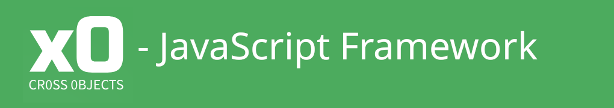

Ultra-lightweight JavaScript In-Browser Real-Time Templating Engine - built on exceptionally strong OOP principles

[](https://github.com/WEBcodeX1/x0/actions/workflows/github-code-scanning/codeql)
[](https://github.com/WEBcodeX1/x0/actions/workflows/ci.yml)
[](https://github.com/WEBcodeX1/x0/blob/main/LICENSE)
[](https://docs.webcodex.de/x0/v1.0/)

---

# Overview

The **x0 framework** is an **ultra-lightweight**, **serverless** in-browser RTTE (Real-Time Templating Engine)
designed to run **entirely independent** of backend or server-side code. Built on a **clean, object-oriented**
programming (OOP) foundation, it **drastically minimizes code complexity** by replacing heavy imperative logic
with a **highly efficient declarative metadata** concept.

The framework can be statically loaded from any standard web server, comprising just 56 system and 4 object
metadata definition files with a core footprint of only 500 Kilobytes. It depends on **Bootstrap** and optionally
utilizes **Font Awesome** for its UI components. Even with a minimalist setup of both libraries, extensive user
metadata, and custom application code, the total deployment size remains under 4 Megabytes for a complete client
/ server architecture. Because the application renders completely within the client browser, it is perfectly
suited for **resource-constrained** environments like embedded **microcontroller** web interfaces.

An example of an *x0-application-driven*, browser-controlled multiplayer **PONG** game running on an **ESP32-S3**
microcontroller using the **ESP-IDF** framework (with embedded *MicroPython*) can be found here:

https://github.com/WEBcodeX1/micropython-as

# Key Features & Architecture

* **Declarative Metadata Concept:** Uses modern declarative configurations to define application behavior, drastically reducing custom boilerplate code.
* **Clean OOP Foundation:** Leverages object-oriented design patterns to minimize architectural complexity and keep the codebase maintainable.
* **Serverless & Independent:** Runs entirely in the browser without depending on a classic backend stack.
* **Ultra-Lightweight Core:** Consists of only 56 system files and 4 metadata files, totaling just 500 KB.
* **Production Footprint < 4 MB:** Includes Bootstrap, Font Awesome, and comprehensive user application code within less than 4 Megabytes.
* **Microcontroller Support:** Ideal for low-resource embedded web interfaces due to full client-side rendering.
* **Modern UI Foundations:** Built on top of Bootstrap with optional, flexible Font Awesome icon support.
* **In-Browser RTTE:** Renders and evolves object-driven interfaces directly in the frontend in real time.
* **Composable Object System:** Combines complex objects into reusable, structured application models using clean OOP abstractions.
* **Multi-Language Support:** Delivers and maps the same underlying object model across multiple display languages.

# Performance Optimization

The **x0 core** engine combines multiple modern JavaScript runtime optimizations to
achieve near-C++ rendering speeds for in-browser **x0 applications**. Using a recursive
iterator pattern on a class hierarchy where each class contains child objects of the
same base class, it constructs a complete object graph during **x0 initialization**.
Because the entire structure is pre-allocated at this stage, traversing from any node
achieves ultra-low latency—further accelerated by a lightweight, reference-based OOP
architecture analogous to a pointer-only hierarchy in C++.

# Quick Start

Try *x0* now instantly.

```bash
# Install docker
apt-get -y install docker.io docker-buildx

# Docker permissions & setup (as root)
usermod -aG docker your-user

# Restart (system) and pull pre-built image
docker pull ghcr.io/webcodex1/x0-static

# Start static Docker container
docker run -p 80:80 x0-static
```

Open `http://localhost` or `http://<your-ip>`, which will display the static 
**x0-application** component containing a rich set of example objects.

---

Full install details including build instructions: [./INSTALL.md](./INSTALL.md).

# Documentation

Rendered docs: [Official Sphinx Documentation](https://docs.webcodex.de/x0/v1.1/).

# Security

PKCS 11/15 compatible. Optional advanced PKI (non-free).
Full details in [WEB/codeX PKI Manager](https://www.webcodex.de/index.html?menu=content-projects-wcdx-pkimanager).

# Examples

See: [./example/README.md](./example/README.md).

# File & Folder Structure

Partial overview, see [GitHub file search](https://github.com/WEBcodeX1/x0/search):

```
├── README.md
├── INSTALL.md
├── debian/
│   └── README.md
├── docker/
│   ├── README.md
│   ├── build-all.sh
│   └── ...
├── doc/
│   ├── index.rst
│   ├── intro.rst
│   ├── dev-examples.rst
│   ├── Makefile
│   └── conf.py
├── example/
│   ├── example1
│   └── example2
├── conf/
│   └── wsgi.conf
├── www/
│   └── sysText.js
├── test/
│   └── README.md
└── ... (more files & folders)
```

# Contributing

Contributions & feedback welcome!
See [./CONTRIBUTING.md](./CONTRIBUTING.md) or open an issue.

# Achieved Milestones

- Standalone static (NoSQL) x0 component (no vhost support)
- Replace Apache with the FalconAS HTTP/1.1 C++ library and embedded MicroPython on ESP32 microcontroller hardware ([Repo](https://github.com/WEBcodeX1/http-1.2))
- Integrate x0 on ESP32 microcontroller hardware, served by FalconAS HTTP/1.1 ([Repo](https://github.com/WEBcodeX1/micropython-as))

# Future Plans / Milestones

- Add virtual host (vhost) support to the standalone static (NoSQL) x0 component
- Roadmap: [GitHub Milestones](https://github.com/WEBcodeX1/x0/milestones)

# Community & Support

- [Discussions](https://github.com/WEBcodeX1/x0/discussions)
- [Issues](https://github.com/WEBcodeX1/x0/issues)
- [Docs](https://docs.webcodex.de/x0/v1.0/)

# License

AGPL-3.0. See [./LICENSE](./LICENSE).

# External References

- [https://kubernetes.io](https://kubernetes.io)
- [https://www.selenium.dev](https://www.selenium.dev)
- [https://www.sphinx-doc.org](https://www.sphinx-doc.org)
- [https://www.devuan.org/](https://www.devuan.org/)
- [https://github.com/WEBcodeX1/http-1.2](https://github.com/WEBcodeX1/http-1.2)

---

<p align="center"><sub>Made with ❤️ by Claus Prüfer / clickIT / WEBcodeX</sub></p>
