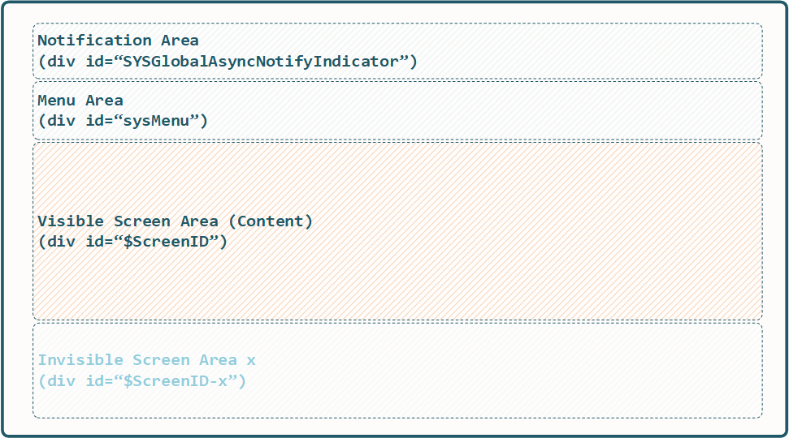
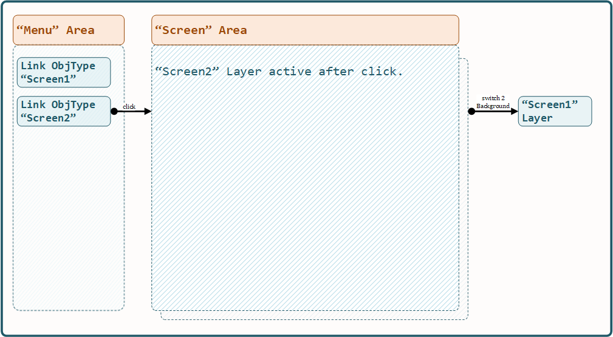

.. appdev-config

.. _appdevconfig:

7. Basic Configuration
======================

This section describes how an *x0-application* is configured: the browser
content areas it is composed of, the database-backed configuration tables,
the application server configuration file, and the declarative JSON metadata
model used to define objects, screens and menus.

.. _appdevconfig-contentareas:

7.1. Browser Content Areas
--------------------------

Historically, an *x0-application* was described as a fixed, three-pane
layout — a **Menu Area**, a **Screen Content Area** and a **Notification
Area** — each bound to a conventionally named, statically positioned DOM
container. The current engine no longer imposes this constraint: all three
areas are created dynamically at runtime by :ref:`devoopmodel_base`
(``sysBaseDOMElement``/``sysBaseObject``) rather than being hard-coded into
the page markup, and each is positioned independently via CSS. In
combination with custom stylesheets and core *x0* features, any of these
regions can therefore be placed anywhere within the viewport, resized,
hidden, or repurposed without touching the engine itself.

   Browser Content Areas

.. tip::
   Screen areas not currently in focus are not destroyed; they remain
   present as invisible layers, which is what enables instantaneous,
   stateful transitions between screens (see :ref:`appdevconfig-statepreservation`).

7.1.1. Menu Area
****************

The **Menu Area** is set up exactly like any other screen: it is a regular
``sysScreen`` instance (DOM id: ``sysMenu``) whose object tree is loaded from
``menu.json`` on page load. Because it uses the same generic setup mechanism
as the Screen Content Area, the Menu Area is **not restricted to static menu
links** — it is a generic, ultra-flexible layout container capable of
hosting **any** valid *x0-system-object* or declarative UI component. The
bundled static example demonstrates this directly: its menu is composed of
an ``Image`` object (the application logo) and a ``TreeSimple`` object (the
navigation tree), with no dedicated "link" object involved at all.

-  Menu objects are referenced in ``menu.json`` and defined in
   ``object.json``, exactly as for any other screen (see
   :ref:`appdevconfig-metadata`).
-  Activating a navigation entry switches the active screen in the Screen
   Content Area.
-  Positioning is CSS-driven (see :ref:`appdevconfig-positioning`).

7.1.2. Screen Area
******************

-  The main stage for application content.
-  ``default_screen`` selects the screen shown on page load (see
   :ref:`appdevconfig-systemconfig`).
-  The object hierarchy of each screen is defined in ``skeleton.json``.
-  Layout within a screen is controlled by CSS (e.g. the Bootstrap grid) or
   by the :ref:`appdevgridsystem`.

   Screen Switch

7.1.3. Notification Area
************************

-  Displays asynchronous status messages raised by backend/web-service
   calls.
-  Implemented as a regular *x0-system-object* (``sysObjAsyncNotify``) like
   any other, and positioned independently via CSS.

.. _appdevconfig-statepreservation:

7.1.4. Object State Preservation
********************************

Because inactive screens persist as invisible layers rather than being torn
down, x0 guarantees **full state preservation**: switching screens or tabs,
or navigating via the Menu Area, never resets object state.

-  Example #15 - Tree Simple demonstrates this behavior:
   ``https://download.webcodex.de/x0/video/x0-example-15-tree-simple.mkv``

.. _appdevconfig-positioning:

7.1.5. Area Positioning / CSS
-----------------------------

-  Layout is implemented with the Bootstrap grid for responsive
   positioning, e.g. ``<body class="row">`` combined with ``col-md-x``
   classes per area.
-  The Menu Area defaults to ``position: absolute``, but this is a styling
   default only and fully overridable.
-  See the `Bootstrap Grid documentation
   <https://getbootstrap.com/docs/5.3/layout/grid/>`__ for the underlying
   grid mechanics.

7.2. Database Configuration
---------------------------

Application configuration data is stored in the ``system.config`` and
``webui.text`` database tables.

-  The corresponding SQL scripts live under ``/database``.
-  These scripts are applied automatically during the Docker image build.

.. _appdevconfig-systemconfig:

7.2.1. System Configuration
***************************

The relevant ``system.config`` parameters are:

.. table:: System Configuration Parameters
   :widths: 25 20 55

   +-----------------------+----------------+---------------------------------+
   | **Parameter**         | **Type**       | **Description**                 |
   +=======================+================+=================================+
   | index_title           | String         | Page title                      |
   +-----------------------+----------------+---------------------------------+
   | debug_level           | Integer        | Client-side debug log level     |
   +-----------------------+----------------+---------------------------------+
   | display_language      | ``en`` / ``de``| Default UI language             |
   +-----------------------+----------------+---------------------------------+
   | default_screen        | String         | Screen ID shown on page load    |
   +-----------------------+----------------+---------------------------------+
   | parent_window_url     | String (URL)   | Parent (e.g. WordPress) plugin  |
   |                       |                | URL                             |
   +-----------------------+----------------+---------------------------------+
   | subdir                | String (Path)  | Static backend path             |
   +-----------------------+----------------+---------------------------------+
   | message_handler       | Boolean        | Enable (``true``) message       |
   |                       |                | handling                        |
   +-----------------------+----------------+---------------------------------+
   | config_file_menu      | String         | Menu config filename            |
   +-----------------------+----------------+---------------------------------+
   | config_file_object    | String         | Object config filename          |
   +-----------------------+----------------+---------------------------------+
   | config_file_skeleton  | String         | Skeleton config filename        |
   +-----------------------+----------------+---------------------------------+

.. code-block:: sql

   INSERT INTO system.config (config_group, "value") VALUES ('index_title', 'x0 Default App');

7.2.2. Display Text
*******************

-  Multi-language text is stored in ``webui.text``.
-  Text IDs defined there are referenced from the JSON configuration files.

.. code-block:: sql

   INSERT INTO webui.text (id, "group", value_en, value_de)
   VALUES ('TXT.TEXTID.1', 'group1', 'English Text #1', 'German Text #1');

7.2.3. Application ID
*********************

-  Appending ``?appid=example2`` to the application URL loads an
   alternative configuration set.
-  Each ``app_id`` is backed by its own set of configuration rows.

.. _appdevconfig-serverconfig:

7.3. Application Server Config (``app-config.json``)
----------------------------------------------------

``/config/app-config.json`` defines database authentication, virtual hosts
and the *x0-applications* served per vhost. The full property reference for
this file is documented in :ref:`appdeployment-kubernetes`; this section
summarizes the parts relevant to day-to-day application development.

.. important::
   Multi-virtual-host and multi-environment support requires a properly
   configured and packaged database-backed deployment; it is not available
   in the standalone :ref:`installation-quickstart` container.

7.3.1. Database Authentication
******************************

The following database users are created automatically during the Docker
image build:

-  ``postgres`` (``su_password``)
-  ``x0`` (``x0_password``)
-  ``replication`` (``repl_password``)

7.3.2. Virtual Hosts
********************

-  Apache virtual hosts are generated from the JSON configuration during
   the Docker build.
-  SSL/TLS is only fully automated for Kubernetes deployments (see
   :ref:`appdeployment-kubernetes`).

7.3.3. x0-Applications
**********************

-  A single vhost may serve multiple *x0-applications* in parallel (see
   the ``apps`` list below); this is available for any database-backed
   deployment, not only Kubernetes.

7.3.4. Default Config Example
*****************************

.. code-block:: json

   {
     "installer": { "type": "x0" },
     "database": { "name": "x0", "su_password": "changeme", "x0_password": "changeme" },
     "env_list": [ "default" ],
     "vhosts": {
       "x0-app": {
         "apps": [ "x0" ],
         "env": {
           "default": {
             "dns": { "hostname": "x0-app", "domain": "x0.localnet" }
           }
         }
       }
     }
   }

.. _appdevconfig-metadata:

7.4. Application Metadata & Object Model
----------------------------------------

x0 applications are defined through a declarative, JSON-driven metadata
model consisting of three files:

-  **object.json** — all *x0-system-objects*, their attributes and metadata.
-  **skeleton.json** — how objects and screens are structured and related.
-  **menu.json** — the menu's object tree and navigation hierarchy.

**Load order:**

1. ``skeleton.json`` initializes the UI hierarchy.
2. ``object.json`` defines the objects referenced by that hierarchy, which
   are instantiated dynamically.
3. ``menu.json`` builds the menu structure, using the same syntax and
   mechanism as ``skeleton.json`` (see :ref:`appdevconfig-contentareas`).

7.4.1. object.json
******************

Each object is declared as:

.. code-block:: json

   {
     "$ObjectID": {
       "Type": "$ObjectType",
       "Attributes": {}
     }
   }

-  ``$ObjectID`` is referenced from ``menu.json`` and ``skeleton.json``.

7.4.2. skeleton.json
********************

Defines which screen each object belongs to, e.g.:

.. code-block:: json

   {
     "Screen1": [
       { "Object1": { "RefID": "Screen1" } }
     ]
   }

7.4.3. menu.json
****************

Uses the same syntax as ``skeleton.json``, but the root ``RefID`` is always
``sysMenu`` (see :ref:`appdevconfig-contentareas`).

7.5. Metadata ElementID
-----------------------

Object elements (e.g. tabs within a tab container) are referenced via the
``ElementID`` property in ``skeleton.json``.

Example: Tab Container
**********************

**object.json**

.. code-block:: json

   {
     "TabContainer1": {
       "Type": "TabContainer",
       "Attributes": {
         "Tabs": [
           { "ID": "Tab1", "Default": true, "TextID": "TXT.BASIC-TABCONTAINER.TAB1", "Style": "col-md-4" },
           { "ID": "Tab2", "TextID": "TXT.BASIC-TABCONTAINER.TAB2", "Style": "col-md-8" }
         ]
       }
     }
   }

**skeleton.json**

.. code-block:: json

   {
     "Screen1": [
       { "TabContainer1": { "RefID": "Screen1" } },
       { "Text1": { "RefID": "TabContainer1", "ElementID": "Tab1" } },
       { "Text2": { "RefID": "TabContainer1", "ElementID": "Tab2" } }
     ]
   }

7.6. Object Templates
---------------------

-  Custom object templates are registered via the ``template_file`` and
   ``setup_class`` configuration parameters in the database.
-  ``.js`` template files are placed under ``/static``.
-  See :ref:`devobjectmodeling` for the underlying object model.
