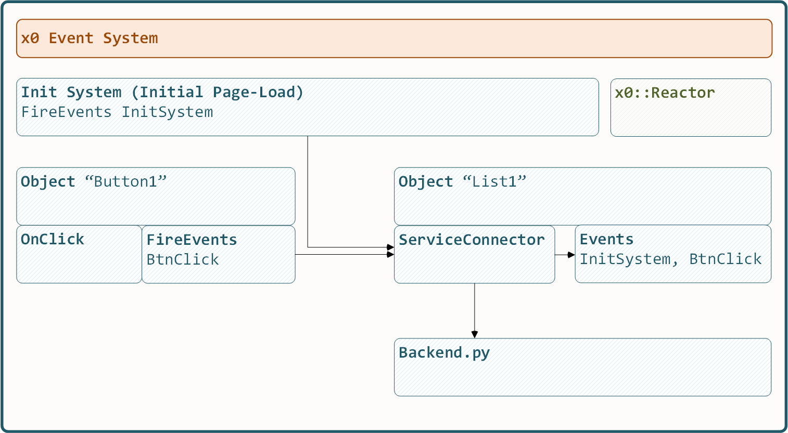

.. appdev-event-system

.. _appdeveventsystem:

15. Event-System
================

15.1. Intro
-----------

The *x0-event-system* is the framework's internal publish/subscribe mechanism: it
decouples the *x0-system-objects* that raise an event (a button click, a tab switch,
a form field changing value, the application completing its bootstrap) from the
*x0-system-objects* that must react to it (typically a ``ServiceConnector`` re-fetching
backend data, or another object changing its visible/activated state). Neither side
ever holds a direct reference to the other; both only know about *x0-events* by their
``EventID``.

Any *x0-system-object* is able to register to multiple *x0-events*, and any
*x0-system-object* that supports it (see 15.5) can raise ("fire") one or more events
as a side effect of its own processing. Processed events fall into two architecturally
distinct categories:

* **Backend-Related Events** (15.4): an event registration triggers a remote service
  call, bridging the event system to the backend via a ``ServiceConnector``.
* **Non-Backend-Related (Internal) Events** (15.5): an event registration triggers a
  purely client-side reaction -- no network request is ever involved, and the full
  round-trip executes synchronously within the browser.

.. note::

    Some *x0-object-types*, e.g., the **List** object, will be completely removed from
    the DOM and re-rendered by invoking ``callbackXMLRPCAsync()`` method when its
    backing data is reloaded as a reaction to a dispatched event.

15.2. Core Engine Components
-----------------------------

The event system is implemented across four cooperating engine source files, each with
a single, well-defined responsibility:

    - ``sysReactor.js`` (``sysReactor`` / ``sysEvent``, singleton instance
      ``sysFactory.Reactor``): the central hub for event subscription, tracking and
      orchestration. Holds every currently registered ``sysEvent`` and is the sole
      component responsible for matching a dispatched ``EventID``/``EventSelector``
      pair against those registrations and invoking the associated callback. See
      :ref:`devoopmodel` (section 23.5) for the full method-level reference.
    - ``sysServiceConnector.js`` (``sysServiceConnector``): manages the synchronization
      between the event system and an external backend resource. A ``ServiceConnector``
      registers itself with the reactor for one or more *x0-events* and, once a
      matching event is dispatched, bridges to the backend API by triggering its
      connected child object's data retrieval. See :ref:`devoopmodel` (section 23.8.1)
      and :ref:`appdev-backend` (14.2).
    - ``sysSourceObjectHandler.js`` (``sysSourceObjectHandler``, mixed into
      ``sysServiceConnector``, ``sysObjButton`` and ``sysObjList`` via
      ``processSourceObjects()``): evaluates a ``SrcDataObjects`` declaration, resolves
      every referenced *x0-system-object* or global variable, and maps the resulting
      payload onto the outgoing request. See :ref:`appdev-backend` (14.3/14.4) for the
      full declarative schema.
    - ``sysRequestDataHandler.js`` (``sysRequestDataHandler``): a small, dependency-free
      data container (``RequestData`` / ``ServiceData``) that accumulates and reshapes
      the payload assembled by ``sysSourceObjectHandler`` before it is handed to the
      backend call. See :ref:`devoopmodel` (section 23.8.2).

15.3. Declarative Event Registration
--------------------------------------

Any object registering with the reactor (directly, or via ``sysServiceConnector``,
see 15.4) uses the same ``OnEvent`` attribute shape:

.. table:: Declarative Event Registration Schema (OnEvent)
	:widths: 16 14 90

	+---------------+----------+------------------------------------------------------------------------------------------------------------------------------------------------------+
	| **Property**  | **Type** | **Description**                                                                                                                                      |
	+===============+==========+======================================================================================================================================================+
	| Events        | Array    | Entries are either plain ``EventID`` strings or ``{ EventID, EventSelector }`` objects                                                               |
	+---------------+----------+------------------------------------------------------------------------------------------------------------------------------------------------------+
	| EventID       | String   | Identifier matched against the ID of a dispatched event                                                                                              |
	+---------------+----------+------------------------------------------------------------------------------------------------------------------------------------------------------+
	| EventSelector | String   | Optional discriminator; several registrations may share one ``EventID`` while reacting only to a specific selector value (e.g. one per ``ScreenID``) |
	+---------------+----------+------------------------------------------------------------------------------------------------------------------------------------------------------+

.. code-block:: javascript

	"OnEvent":
	{
		"Events": [ "InitSystem", { "EventID": "SwitchScreen", "EventSelector": "Screen1" } ]
	}

15.3.1. Built-in System Events
*******************************

Two *x0-system-events* are dispatched automatically by the engine and require no
explicit "fire" configuration anywhere -- any object may register for them:

    - ``InitSystem``: dispatched exactly once by ``sysFactory.init()`` after every
      screen has been built and the default screen has been switched to, signalling
      that the application has reached its final running state.
    - ``SwitchScreen``: dispatched by ``sysFactory.switchScreen(ScreenID)`` every time
      the active screen changes, using the destination ``ScreenID`` as the
      ``EventSelector`` -- allowing a registration to react only to a specific screen
      becoming active.

15.4. Backend-Related Events
-------------------------------

A ``ServiceConnector`` object defines **where** to get backend data from (``OnEvent.
ServiceCall``) and **when** (``OnEvent.Events``). Once connected as the ``ParentObject``
of a data-bearing child in ``skeleton.json``, every matching dispatched event causes
``sysServiceConnector.EventCallback()`` to resolve the configured ``SrcDataObjects``
(via ``sysSourceObjectHandler.processSourceObjects()``), accumulate the request payload
(via ``sysRequestDataHandler``), and trigger the connected child object's backend data
retrieval.

Full configuration details, ``object.json``/``skeleton.json`` examples and the complete
``SrcDataObjects`` schema are documented in :ref:`appdev-backend` (chapter 14).

15.5. Non-Backend-Related (Internal) Events
-----------------------------------------------

Several *x0-object-types* can raise ("fire") one or more *x0-events* as a pure,
zero-latency client-side side effect of their own processing, with no backend
involvement whatsoever. The table below is the complete inventory of currently active
fire-triggers:

.. table:: Non-Backend-Related (Internal) Fire-Trigger Inventory
	:widths: 20 95 35

	+-------------------+-------------------------------------------------------------------------------------------------------------------------------------+--------------------------------------------+
	| **Source**        | **Trigger Condition**                                                                                                               | **Reference**                              |
	+===================+=====================================================================================================================================+============================================+
	| Button            | Attributes.FireEvents, after successful Form Validation (and per-Action FireEvents in OnResult, after successful Service Execution) | see 16.1, :ref:`objecttype-button`         |
	+-------------------+-------------------------------------------------------------------------------------------------------------------------------------+--------------------------------------------+
	| ButtonInternal    | Attributes.FireEvents, after successful Form Validation                                                                             | see 16.2, :ref:`objecttype-buttoninternal` |
	+-------------------+-------------------------------------------------------------------------------------------------------------------------------------+--------------------------------------------+
	| Tab               | Tab-level FireEvents, on tab switch                                                                                                 | :ref:`objecttype-tabcontainer`             |
	+-------------------+-------------------------------------------------------------------------------------------------------------------------------------+--------------------------------------------+
	| FormfieldOnChange | OnChange.FireEvents, on matching form value change                                                                                  | :ref:`appdevforms` (17.3.6)                |
	+-------------------+-------------------------------------------------------------------------------------------------------------------------------------+--------------------------------------------+
	| NotifyIndicator   | Notify.OnSuccess.FireEvents, on successful async backend notification                                                               | :ref:`appdev-backend-notify`               |
	+-------------------+-------------------------------------------------------------------------------------------------------------------------------------+--------------------------------------------+
	| ContextMenu       | ItemConfig.FireEvents, on context menu item click                                                                                   | :ref:`appdevcontextmenu`                   |
	+-------------------+-------------------------------------------------------------------------------------------------------------------------------------+--------------------------------------------+

In addition, two further categories of declarative, event-adjacent behaviour exist:

    - **Condition Validators**: the ``FormfieldOnChange`` handler's
      ``EnableOnValues`` / ``DisableOnValues`` / ``ActivateOnValues`` /
      ``DeactivateOnValues`` arrays gate a destination object's visible/activated
      state on the changed field's current value, independent of (and composable
      with) that same handler's ``FireEvents`` (see :ref:`appdevforms`, 17.3).
    - **Execution Hooks**: the ``Action`` / ``OnResult`` attributes of ``Button`` and
      ``ButtonInternal`` dispatch a named, built-in operation (``enable``, ``disable``,
      ``activate``, ``deactivate``, ``reset``, ``switchscreen``, ``tabswitch``, ...)
      against a referenced object *before* (``Action``) or *after* (``OnResult``) the
      control-flow step described in 16.1/16.2, independent of (and composable with)
      ``FireEvents`` (see :ref:`objecttype-button`, 10.3.2/10.3.3).

.. _appdevcontrolflow:

16. Control Flow Items
======================

The next sub-chapters describe the logical control-flow and in which order
they are processed.

.. _appdevcontrolbutton:

16.1. Button
------------

* Backend Service Execution
* Execute Action **after** successful Form Validation 
* Fire Events **after** successful Form Validation
* Execute OnResult Actions **after** successful Service Execution
* Fire Events **after** successful Service Execution

.. _appdevcontrolbuttoninternal:

16.2. ButtonInternal
--------------------

* No Backend Service Execution
* Form Validation
* Execute Action **after** successful Form Validation 
* Fire Events **after** successful Form Validation
