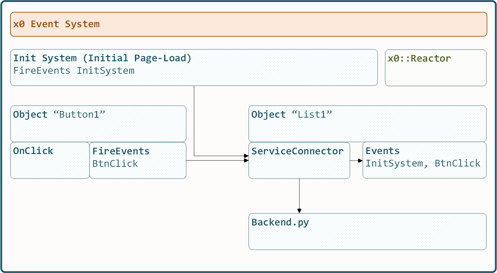

.. appdev-event-system

.. _appdeveventsystem:

15. Event System
================

15.1. Introduction
------------------

*x0-events* are handled internally by the **x0::Reactor** component (``sysReactor.js``).
This mechanism processes the following subtypes in a generic way:

- **Backend-Related Event Processing:** An event execution triggers a remote service
  call, bridging the event system to the backend via a ``ServiceConnector``.

- **Internal Event Processing:** An event execution triggers a
  purely client-side reaction without any network request.

15.2. Generic Implementation
----------------------------

An event exchange *always* involves an

- **x0-event-producer** and
- **x0-event-receiver** object.

Regardless of the processing type, events are handled transparently. The sole exception
applies to the backend-related method on the receiver object type: here, a ``ServiceConnector``
configuration must be **bound** (referenced in ``skeleton.json``) to a pre-existing
object definition inside ``object.json``. This design explicitly separates the configuration
properties of the event producer (direct ``JSONConfig``) from those of the event receiver.

The following chapters document the **Declarative Configuration** (for backend-related
receivers). The **Programmatic Implementation** (for custom-setup *x0-objects*) can be
found in the system developer's guide (see: ).

.. important::
   The illustration above shows the *x0-object-type* ``List`` with the name **List1**,
   which has two connected events: **InitSystem** and **BtnClick**. Whenever either event
   is triggered, the list is populated (updated) with data from the **Backend.py** service
   call.

.. _appdevserviceconnector:

15.3. Backend Connector
-----------------------

To populate an *x0-object* with data from an asynchronous backend service call, a
special *x0-object* of type ``ServiceConnector`` is used.

In addition to the ``Events`` array, a backend configuration must always contain the
``ServiceCall`` property, which specifies the service URL. The network request is executed
by the *x0-system-call* ``sysCallXMLRPC()``. The **request type** here is always **POST**,
and the HTTP POST payload can be configured using the internal x0 ``SourceDataObjects``
mechanism to smartly append structures (e.g., to provide filtering parameters) to the
backend service calls.

The following example demonstrates a working setup using a ``FormfieldList`` object as the
receiver type; however, any *x0-producer-type* can trigger events for it (see :ref:`eventproducertypes`).

15.3.1. ServiceConnector Config
-------------------------------

First we need to define the service properties inside ``object.json`` of type ``ServiceConnector``.

.. code-block:: javascript

   "ConnectorObjectID":
   {
      "Type": "ServiceConnector",
      "Attributes":
      {
         "OnEvent":
         {
            "Events": [ "InitSystem", "CustomEvent2" ],
            "ServiceCall": "/python/BackendService.py"
         }
      }
   }

15.3.2. Receiver Config
-----------------------

Afterwards, a system-supported object type must be added to ``object.json``. Note
that the configuration of two form fields has also been included to demonstrate a correct
``FormfieldList`` setup.

.. important::
   Please note: The ``FormfieldList`` object will only receive data once these objects
   are **connected** inside ``skeleton.json``, which is described in the next step (15.3.3).

.. code-block:: javascript

   "ReceiverObjectID":
   {
      "Type": "FormfieldList",
      "Attributes":
      {
         "ObjectIDs": [
            "FormfieldLabel1",
            "Formfield1"
         ],
         "Style": "border rounded p-2",
         "RowStyle": "row m-0 p1",
         "RowAfterElements": 2,
         "ColAfterElements": 1,
         "ColStyle": [
            "col-md-6",
            "col-md-6"
         ]
      }
   },

   "FormfieldLabel1":
   {
      "Type": "FormfieldLabel",
      "Attributes": {
         "Style": "p-1 w-100 text-primary-emphasis",
         "IconStyle": "fa-solid fa-id-card",
         "TextID": "TXT.FORMLABEL1"
      }
   },

   "Formfield1":
   {
      "Type": "FormfieldText",
      "Attributes": {
         "Style": "form-control border-secondary m-1 p-2 w-100 text-primary-emphasis"
      }
   }

15.3.3. Object Relation
-----------------------

Finally, with the following setup in ``skeleton.json``, the receiver object receives
data during system initialization / page load (the **InitSystem** event) **and** when another
producer object triggers the **CustomEvent2** event (e.g., via a button click).

.. code-block:: javascript

   {
      "Screen1":
      [
         {
            "ConnectorObjectID":
            {
               "RefID": "Screen1"
            }
         },
         {
            "ReceiverObjectID":
            {
               "RefID": "ConnectorObjectID"
            }
         }
      ]
   }

15.3.5. Callback Data
---------------------

Currently, it remains unclear how a) the data from the backend must be structured,
and b) how this data will be mapped to individual form fields inside the FormfieldList
or other *x0-object-types*.

In detail, when a *x0-event* is received and the object is connected to the
corresponding ``ServiceConnector``, an asynchronous ``sysXMLRPCRequest.js`` call is
triggered. Upon successful data retrieval, the object instance's static method
``callbackXMLRPCAsync()`` is invoked with the JSON data resulting from this service call.

This JSON data must conform to the object's internal data schema. To provide a generic
approach for most *x0-object-types*, this structure is a key/value-based object
(for the ``FormfieldList`` type) or an array of multiple key/value-based objects
(for the ``List`` type).

Furthermore, the choice of the redraw algorithm is handled by the object itself. For
example, when a ``List`` receives a list of updated rows, the entire object is
rerendered. However, if it receives a single-row update, only the existing DOM column
values are updated. Consequently, a ``FormfieldList`` typically only needs to update
the existing DOM without triggering a full redraw.

Valid ``FormfieldList`` schema:

.. code-block:: javascript

   { "FormField1": "Value1", "FormField2": "Value2", "FormField3": "Value3" }

Valid ``List`` (multiple rows) schema:

.. code-block:: javascript

   [
      { "RowColumn1": "Value1", "RowColumn2": "Value2", "RowColumn3": "Value3" },
      { "RowColumn1": "Value4", "RowColumn2": "Value5", "RowColumn3": "Value6" },
      { "RowColumn1": "Value7", "RowColumn2": "Value8", "RowColumn3": "Value9" }
   ]

.. important::
   Currently, most object types handle data within their callback routines using hardcoded
   logic after it is fetched from backend services. The recommended approach is to process
   this data transparently using ``setObjectData()``. A generic handler for this mechanism
   is scheduled for the x0 release, version 1.2.

.. _eventproducertypes:

15.4. System Producer Types
---------------------------

The following *x0-object-types* can trigger events. For detailed information on
their configuration, please refer to the documentation under :ref:`systemobjects`.

- ``Button``
- ``ButtonInternal``
- ``Tab``
- ``FormfieldOnChange``
- ``ContextMenu``

15.5. Built-in System Events
----------------------------

Two *x0-system-events* are dispatched automatically by the engine and require no
explicit "fire" configuration anywhere -- any object may register for them:

- ``InitSystem``: dispatched exactly once by ``sysFactory.init()`` after every
  screen has been built and the default screen has been switched to, signalling
  that the application has reached its final running state.

- ``SwitchScreen``: dispatched by ``sysFactory.switchScreen(ScreenID)`` every time
  the active screen changes, using the destination ``ScreenID`` as the
  ``EventSelector`` -- allowing a registration to react only to a specific screen
  becoming active.

.. _appdevcontrolflow:

15.6. Source Data Objects
-------------------------

The *x0-source-data-objects* **x0::sysSourceObjectHandler** component
(``sysSourceObjectHandler.js``) provides an efficient way to control which
data is **additionally appended** to a backend service request. Specifically,
it attaches this data to the **root** JSON metadata sent via asynchronous
POST requests.

Injecting data from a ``Formfield`` or ``FormfieldList`` is particularly useful
for filtering. For example, you can pass a ``DateFrom`` and a ``DateTo`` form
input value to filter the backend dataset between two specific dates.

The Source Data Objects mechanism is not limited to system objects; various other
data sources can be used. These options are detailed in the following
sub-chapters:

- Single System Objects
- Multiple System Objects
- Hardcoded Values
- Global Variables
- Global Screen Variables

The configuration must be declaratively defined in the root of an object's
``Attributes`` section. It will only be processed if it is correctly paired with
a corresponding ``ServiceConnector`` setup.

The following example shows a ``FormfieldList`` configuration with a single referenced
object and three hardcoded values: "LimitRows", "DateFrom", and "DateTo":

.. code-block:: javascript

   "ReceiverObjectID":
   {
      "Type": "FormfieldList",
      "Attributes":
      {
         "ObjectIDs": [
            "FormfieldLabel1",
            "Formfield1"
         ],
         "Style": "border rounded p-2",
         "RowStyle": "row m-0 p1",
         "RowAfterElements": 2,
         "ColAfterElements": 1,
         "ColStyle": [
            "col-md-6",
            "col-md-6"
         ],
         "SrcDataObjects":
         {
            "RefObject1":
            {
               "Type": "GlobalObject"
            },
            "Dummy":
            {
               "Type": "HardcodedValues",
               "Values": {
                  "LimitRows": 10,
                  "DateFrom": "2024-01-12",
                  "DateTo": "2025-01-12"
               }
            }
         }
      }
   }

15.6.1. Single Object
*********************

Use the ``GlobalObject`` SrcDataObject type to include hardcoded values in
a backend request:

.. code-block:: javascript

   "SrcDataObjects":
   {
      "RefObject1":
      {
          "Type": "GlobalObject"
      }
   }

15.6.2. Multiple Objects
************************

Reference multiple *x0-objects* easily by only applying an array of object ids:

.. code-block:: javascript

   "SrcDataObjects":
   [
      "ObjectID1",
      "ObjectID2",
      "ObjectID3"
   ]

15.6.3. Hardcoded Values
************************

Use the ``HardcodedValues`` SrcDataObject type to include hardcoded values in
a backend request:

.. code-block:: javascript

   "SrcDataObjects":
   {
      "Dummy":
      {
         "Type": "HardcodedValues",
         "Values": {
            "LimitRows": 20
         }
      }
   }

15.6.4. Global Variables
************************

Use the ``GlobalVar`` SrcDataObject type to include individual application-wide
global variables in a backend request:

.. code-block:: javascript

   "SrcDataObjects":
   {
      "MyGlobalKey":
      {
         "Type": "GlobalVar"
      }
   }

15.6.5. Global Screen Variables
*******************************

Use the ``ScreenGlobalVar`` SrcDataObject type to forward a screen-level variable
to the backend. Specify the source screen with ``ScreenID``:

.. code-block:: javascript

   "SrcDataObjects":
   {
      "MyScreenKey":
      {
         "Type": "ScreenGlobalVar",
         "ScreenID": "Screen1"
      }
   }

.. _event-actions:

16. Actions
===========

*x0-actions* are only valid for *x0-object-types* of the **button** kind.

.. warning::
   They are a legacy feature and are planned to be merged into the generic
   function dispatcher / event system in x0 version 1.2.

.. table:: Actions References
   :widths: 10 30 60

   +-----------------+----------------------------------+-----------------------------------------------------+
   | Value           | Dispatched Internal Function     | Attributes                                          |
   +=================+==================================+=====================================================+
   | set             | ``setObjectData()``              | Using ``SrcDataObject`` and ``DstDataObject``.      |
   +-----------------+----------------------------------+-----------------------------------------------------+
   | enable          | ``setDOMVisibleState()``         | Using ``DstObjectID``.                              |
   +-----------------+----------------------------------+-----------------------------------------------------+
   | disable         | ``setDOMVisibleState()``         | Using ``DstObjectID``.                              |
   +-----------------+----------------------------------+-----------------------------------------------------+
   | activate        | ``setActivated()``               | Using ``DstObjectID``.                              |
   +-----------------+----------------------------------+-----------------------------------------------------+
   | deactivate      | ``setDeactivated()``             | Using ``DstObjectID``.                              |
   +-----------------+----------------------------------+-----------------------------------------------------+
   | reset           | ``reset()``                      | Using ``DstObjectID``.                              |
   +-----------------+----------------------------------+-----------------------------------------------------+
   | tabswitch       | ``switchTab()``                  | Using ``Tab`` and ``TabContainer``.                 |
   +-----------------+----------------------------------+-----------------------------------------------------+
   | switchscreen    | ``switchScreen()``               | Using ``DstScreenID``.                              |
   +-----------------+----------------------------------+-----------------------------------------------------+
   | setglobalvar    | ``setGlobalVar()``               | Using ``SetVar`` and ``SetValue``.                  |
   +-----------------+----------------------------------+-----------------------------------------------------+
   | openoverlay     | ``activateOverlay()``            | Using ``ScreenID``.                                 |
   +-----------------+----------------------------------+-----------------------------------------------------+

The following sub-chapters describe the logical control flow of the different object
types and the order in which they are processed.

.. _appdevactionbutton:

16.1. Button
------------

* Backend Service Execution
* Execute Action *after* **successful** Form Validation
* Fire Events *after* **successful** Form Validation
* Execute OnResult Actions *after* **successful** Service Execution
* Fire Events *after* **successful** Service Execution

.. _appdevactionbuttoninternal:

16.2. ButtonInternal
--------------------

* No Backend Service Execution
* Form Validation
* Execute Action *after* **successful** Form Validation
* Fire Events *after* **successful** Form Validation
