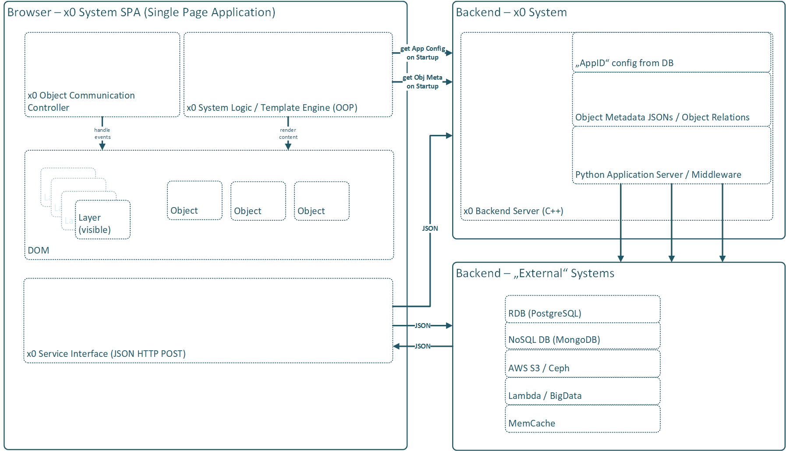
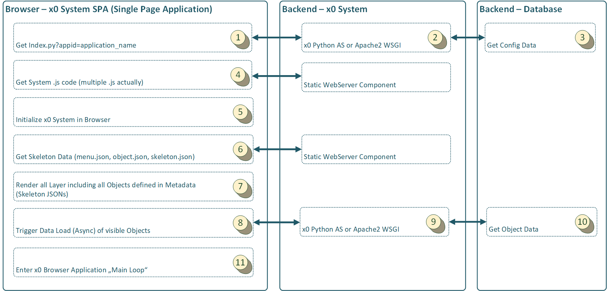
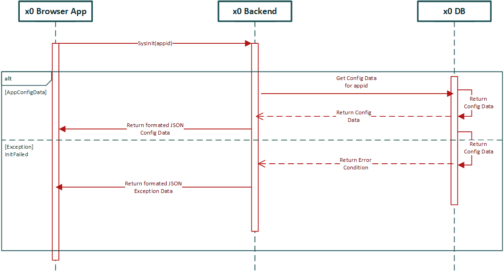
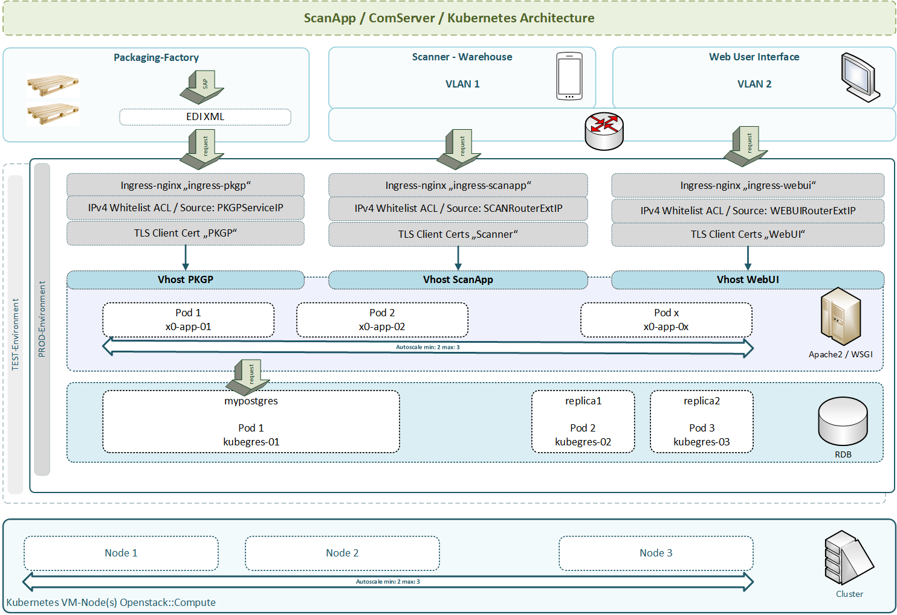

.. dev-architecture

.. _dev-architecture:

21. System Architecture
=======================

This chapter introduces the **developer documentation** section. The
architectural diagram below provides an overview of communication across
global systems.

21.1. Global Workflows
----------------------

The **most important** framework process a developer should be aware of is
**system initialization**, later referenced as *x0-init*. The following
diagrams illustrate the *x0-init* process, first from a **logical perspective**
and second as a **UML diagram**.

21.1.1. Init Logical
********************

21.1.2. Init UML Sequence
*************************

21.2. Kubernetes Platform
-------------------------

The following diagram illustrates an *x0-generated* Google Kubernetes Engine (GKE)
network environment serving as a **demo application**, initialized by the
*x0-kubernetes-installer*.

The primary purpose of this application is to manage a **large-scale** industrial
**packaging system** and **warehouse operations**.

The application is divided into three subcomponents:

1. Packaging Factory (EDI–SAP system interconnect)
2. Warehouse Android Scanner Devices
3. Web Administration / Application Control Plane

